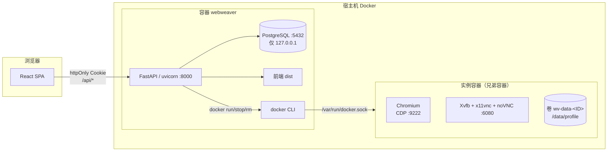

# 01 · 架构

## 1. 系统定位

WebWeaver 管理的是「浏览器实例」这一类资源，不是爬虫任务本身：

- **资源侧**：分组、平台账号、出口代理、指纹模板、内核引擎与版本；
- **运行侧**：把「内核 + 指纹 + 出口 + 账号」组合成一个实例，起停容器、暴露 noVNC 与 CDP；
- **治理侧**：登录、角色权限、审计日志、绑定流水。

它**不做**：任务调度、采集脚本、账号自动登录、代理轮换策略执行。这些由使用方通过
CDP 接管实例后自行实现。代码里没有任务表、没有队列，总览也不展示「待办任务」。

## 2. 运行时拓扑



两个部署形态：

| 形态 | 组成 | 适用 |
|---|---|---|
| **单容器**（默认） | `webweaver` 容器 = PostgreSQL + uvicorn + 前端 dist + docker CLI | 一台机器上的完整体验 |
| **前后端分离** | PG 容器 + `uvicorn --port 8010` + Vite/静态站点 | 本机开发、已有反代与独立数据库 |

单容器不是「把三个进程塞进一个镜像」那么简单：实例容器由容器内的 docker CLI 通过挂载的
socket 创建，所以它们是**兄弟容器**，不是 Docker-in-Docker。代价是容器拥有宿主 Docker 的
控制权，只应部署在受信主机（见 [09 部署](09-deployment.md#8-安全基线)）。

## 3. 一次请求的路径

以 `GET /api/browsers` 为例：

```
浏览器
  → RequestLogMiddleware        生成 request_id，记录耗时，回写 X-Request-ID
  → CORSMiddleware              开发期放行 5173
  → APIRouter(prefix="/api")
  → get_current_context         解析 wv_at Cookie 或 Authorization: Bearer
  → get_snapshot               一次读 6 张表，建好反查索引
  → cluster.browsers(snapshot) 纯函数拼装展示模型
  → BrowserPoolPayload          Pydantic 序列化
```

要点：

- **写接口有权限点，读接口没有**：写接口用 `require_permission("browser:create")`；
  读接口目前只有 `/api/user/*` 与 `/api/auth/me` 挂了登录依赖，其余 GET 匿名可读——
  这是已知安全缺口，见 [04 认证](04-auth-rbac.md#84-接口侧的实际用法)。
- **不要用前端隐藏代替鉴权**：前端按权限点隐藏按钮只是体验，服务端仍然校验写接口。
- 展示数据走 `services/cluster.py` 的**快照**：一次请求读全量业务表（当前规模几百行），
  在内存里做 join，避免 N+1，也让拼装函数可以脱离数据库单测。
- 路由只做鉴权、参数解析和 HTTP 语义；业务规则在 `services/*` 里，方便批量动作复用。

写操作的路径不一样，**先校验再落库再操作外部系统**：

```
路由（权限）→ 服务层校验（唯一性 / 占用 / 状态机）
           → 变更数据库 + 写 audit_logs（+ 绑定流水）
           → 调 Docker（启动 / 停止 / 删除）
           → 把容器真实端口回写数据库
```

外部系统失败时，数据库状态与容器状态可能短暂不一致；下一次启动 / 停止会以 Docker 为准
做纠正（见 [05 运行时](05-browser-runtime.md#5-状态机与一致性)）。

## 4. 关键设计决策

| 决策 | 原因 | 代价 |
|---|---|---|
| **容器名 = 实例 ID（UUID）** | Docker 名称不接受中文，实例名允许中文；改名不必迁移容器；`docker ps` 与页面 ID 一眼对上 | 名字不可读，排查时要回页面查 |
| **profile 放命名卷 `wv-data-<ID>`** | 删容器 / 重建 / 换内核不丢登录态 | 删除实例不删卷，需要人工清理 |
| **镜像即真相** | 版本、大小、构建时间都来自 `docker image ls`，没有第二份需要同步的元数据 | 每次内核页要跑 docker 命令，慢时要有降级提示 |
| **内核切版本只移动指针** | 升级可回滚；老实例不被强迁 | 需要 `stale` 概念与批量迁移入口 |
| **实例端口由应用分配并回写** | Docker 发布端口可能被占用或漂移，库里的值不能当真相 | 启动时要探测宿主端口，逻辑略重 |
| **读接口快照、写接口逐表校验** | 读多写少；写操作必须保证唯一性与外键语义 | 数据量上万后快照要改成分页/缓存 |
| **绑定关系存当前值 + 只追加流水** | 「现在绑了谁」与「什么时候换的」是两类问题 | 每次绑定要写两张表 |
| **双令牌 + httpOnly Cookie** | JS 读不到令牌，XSS 偷不走；刷新令牌轮转可检测重放 | 前端要做静默续期与单飞刷新 |
| **UUID 主键（应用侧生成）** | 多实例不撞号、不暴露数据量、写库前就能返回 ID | 索引比自增略大 |
| **枚举落 VARCHAR + CHECK** | 加枚举值不用 `ALTER TYPE`，迁移简单 | 数据库层约束弱于原生 enum |

## 5. 代码分层

```
app/api/routes/*        HTTP：路径、权限、状态码、请求体
        │
        ▼
app/services/*          业务：校验、状态机、Docker、审计
        │
        ├──────────────► app/models/*      SQLModel 表定义
        └──────────────► app/schemas/*     请求 / 响应 / 展示模型
```

依赖方向是单向的：`routes → services → models`，`schemas` 只被两侧引用，不反向依赖服务。
`services` 之间允许横向调用（例如 `browser_pool` 调 `browser_runtime`、`fingerprint_apply`），
但不允许 `services` 调 `routes`。

| 目录 | 职责 | 不该放什么 |
|---|---|---|
| `api/routes` | 参数、鉴权、HTTP 语义 | 业务判断、SQL |
| `api/deps.py` | 当前用户、会话、权限依赖 | 具体业务 |
| `services` | 业务规则、外部系统调用、审计 | HTTP 异常以外的传输层细节 |
| `models` | 表结构、枚举、约束 | 查询逻辑 |
| `schemas` | 输入校验、输出契约 | 数据库访问 |
| `core` | 配置、DB、安全、Cookie、日志 | 业务 |

## 6. 目录职责

| 路径 | 说明 |
|---|---|
| `backend/app/api/routes/` | 12 个路由模块，统一在 `api/router.py` 注册 |
| `backend/app/services/cluster.py` | 读模型快照与五个页面的 payload 拼装 |
| `backend/app/services/browser_*.py` | 实例写操作、Docker 生命周期、noVNC 能力 |
| `backend/app/services/kernel_*.py` | 镜像扫描、拉取任务、台账与迁移 |
| `backend/app/services/fingerprint_*.py` | 能力矩阵、参数渲染、容器下发、真实人格采集 |
| `backend/app/services/account_pool.py` / `ip_pool.py` | 账号与代理的导入、解析、探测 |
| `backend/app/services/auth_service.py` / `rbac.py` | 登录流程、会话轮转、权限判断 |
| `backend/app/core/` | `config` / `db` / `security` / `cookies` / `logging_config` / `middleware` |
| `backend/tests/` | 单元 + 接口测试；`demo_cluster.py` 是测试专用演示数据 |
| `frontend/src/api/` | `client.ts`（fetch、401 续期）+ `endpoints.ts`（接口清单） |
| `frontend/src/auth/` | `AuthProvider` 与路由守卫 |
| `frontend/src/pages/` | 业务页、`auth/` 四页、`settings/` 四页 |
| `frontend/src/components/` | 布局、UI 套件、表单、弹窗、图标 |
| `browser_engine/` | 三个内核镜像的 Dockerfile、entrypoint、字体与说明 |
| `docker/entrypoint.sh` | 单容器的启动编排（PG → 迁移 → seed → uvicorn） |

## 7. 与外部系统的边界

| 外部系统 | 交互方式 | 失败时的行为 |
|---|---|---|
| Docker daemon | `docker` CLI，`asyncio.to_thread` 包同步子进程 | 抛 `ContainerError`，接口返回 409/503 与可读原因 |
| PostgreSQL | asyncpg + SQLAlchemy 异步会话 | 启动时只告警不阻断；接口报 500 |
| 内核镜像仓库 | `docker pull` | 任务标记失败，页面保留旧版本 |
| 浏览器实例 CDP | HTTP `/json/list` + WebSocket | 采集任务失败并写 `probe_error` |

## 8. 扩展时先想清楚的问题

1. **这是读还是写？** 读走快照 + 纯函数；写要权限、校验、审计三件套。
2. **真相在哪？** 涉及容器的事实（是否在跑、端口、镜像）以 Docker 为准，数据库只存投影。
3. **失败后能否重试？** 启停删必须幂等：容器不存在时停止算成功，启动时按当前状态重建。
4. **要不要留痕？** 任何改变资源状态或绑定关系的动作都要落审计；只读扫描不写审计。
5. **前端需不需要新契约？** 先改 `schemas`，再改 `types/domain.ts`，最后才是页面。
