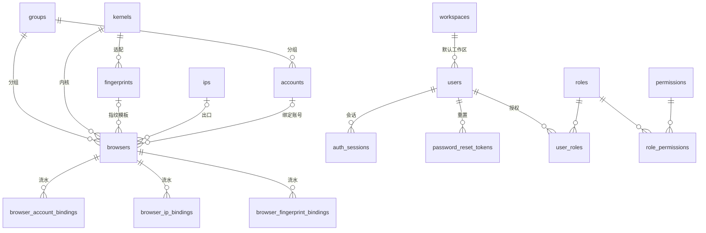

# 03 · 数据模型

## 1. 总览

模型在 `backend/app/models/`，使用 **SQLModel**，共 **18 张业务表**（不含 `alembic_version`）。
主键统一是 `UUID`（`uuid4`，应用侧生成），公共字段由 `IdMixin` / `TimestampMixin` 提供。



## 2. 表清单

| # | 表 | 模型 | 用途 | 关键约束 |
|---|---|---|---|---|
| 1 | `groups` | `Group` | 分组（浏览器 / 账号 / IP），支持二级 | `code` 唯一；`(kind, name)` 唯一 |
| 2 | `kernels` | `Kernel` | 内核引擎台账与当前版本 | `name` 唯一 |
| 3 | `fingerprints` | `Fingerprint` | 指纹模板与实测人格 | `code` 唯一 |
| 4 | `ips` | `Ip` | 出口代理资源 | `(address, port)` 唯一 |
| 5 | `accounts` | `Account` | 平台账号（密码加密、Cookie） | `(login_url, username)` 唯一 |
| 6 | `browsers` | `Browser` | 实例：内核 + 指纹 + 出口 + 账号 | `name` 唯一；两条模式 CHECK |
| 7 | `browser_account_bindings` | `BrowserAccountBinding` | 账号绑定 / 解绑流水 | 只追加 |
| 8 | `browser_ip_bindings` | `BrowserIpBinding` | 出口绑定 / 直连切换流水 | `mode` 与 `ip_id` 成对 |
| 9 | `browser_fingerprint_bindings` | `BrowserFingerprintBinding` | 指纹模板 / 默认模式流水 | `mode` 与 `fingerprint_id` 成对 |
| 10 | `audit_logs` | `AuditLog` | 全量写操作审计 | `resource_id` 不建外键 |
| 11 | `workspaces` | `Workspace` | 工作区 | `code` 唯一 |
| 12 | `users` | `User` | 控制台成员 | `username` / `email` 唯一 |
| 13 | `roles` | `Role` | 角色 | `code` 唯一 |
| 14 | `permissions` | `Permission` | 权限点 `模块:动作` | `code` 唯一 |
| 15 | `user_roles` | `UserRole` | 成员 ↔ 角色 | `(user_id, role_id)` 唯一 |
| 16 | `role_permissions` | `RolePermission` | 角色 ↔ 权限点 | `(role_id, permission_id)` 唯一 |
| 17 | `auth_sessions` | `AuthSession` | 登录会话与刷新令牌摘要 | `refresh_hash` 唯一 |
| 18 | `password_reset_tokens` | `PasswordResetToken` | 一次性重置令牌摘要 | `token_hash` 唯一 |

> `users` 是**控制台成员**，`accounts` 是**平台账号**（Amazon / TikTok 等）。两者无关，
> 命名上不要混。

## 3. 公共约定

`app/models/base.py`：

```python
class IdMixin(SQLModel):
    id: UUID = Field(default_factory=uuid4, primary_key=True, ...)

class TimestampMixin(SQLModel):
    created_at: datetime  # timestamptz, server_default=now()
    updated_at: datetime  # timestamptz, server_default=now(), onupdate=now()
```

- 时间统一 UTC 存储，展示时转本地时区。
- 枚举落库用 `enum_type()`：`VARCHAR(16) + CHECK`，存枚举值，回读自动转成员。
  不用 PostgreSQL 原生 enum —— 加值不必 `ALTER TYPE`。
- 每个字段都有中文 `comment`，迁移后成为数据库的 `COMMENT ON`；`psql \d+` 可见，
  `tests/test_models.py` 会校验表与列不丢注释。
- 外键列一律带索引；`browsers` 的四个资源外键都可空，实例可以先建后绑。

## 4. 核心表字段

### 4.1 `browsers`

| 字段 | 说明 |
|---|---|
| `name` | 实例名，业务唯一；支持中文，≤ 64 字符 |
| `status` | `queued` / `running` / `idle` / `error` / `stopped` |
| `group_id` | 分组，可空 |
| `kernel_id` | 内核台账行 |
| `kernel_version` | 实例钉住的版本；空 = 跟随内核当前版本 |
| `fingerprint_mode` | `template` / `default` |
| `fingerprint_id` | 模板 ID；默认模式为空 |
| `ip_mode` | `proxy` / `direct` |
| `ip_id` | 代理 ID；直连为空 |
| `account_id` | 绑定的平台账号 |
| `cdp_url` / `vnc_url` / `vnc_port` | 运行时信息，启动后回写 |
| `fps` / `latency_ms` | 展示指标 |
| `started_at` / `last_active_at` | 启动时间与最近活跃 |
| `note` | 备注 |

两条 CHECK 保证「模式与资源 ID 不能错配」：

```sql
(ip_mode = 'proxy'  AND ip_id IS NOT NULL) OR
(ip_mode = 'direct' AND ip_id IS NULL)

(fingerprint_mode = 'template' AND fingerprint_id IS NOT NULL) OR
(fingerprint_mode = 'default'  AND fingerprint_id IS NULL)
```

### 4.2 `accounts`

- `login_url`：用户填的登录页地址；`platform` 由域名推导，不手工指定。
- `password_encrypted`：加密后的登录密码，不落明文。
- `cookies`：JSON 数组，导入时可带；详情接口会返回，供复制到外部工具。
- `status`：`logged_in` / `in_session` / `restricted` / `unbound`。
- `health`：0–100，展示与总览健康分使用。

### 4.3 `ips`

- `protocol`：`http` / `https` / `socks5`；`kind`：`residential` / `datacenter` / `mobile`。
- `port = 0` 表示用协议默认端口（http 80 / https 443 / socks5 1080）。
- `username` / `password` 明文存储：前端需要复制「带认证的代理地址」。这是已知取舍，
  不要把 `ips` 表当成密码库复用。
- `status`：`available` / `in_use` / `failed`；`last_checked_at` 由检测接口回写。

### 4.4 `fingerprints`

- 身份：`code` / `name` / `platform_family` / `platform`。
- 下发参数：`seed`、`platform_version`、`brand`、`brand_version`、
  `hardware_concurrency`、`timezone`、`language`、`accept_lang`、四类噪声开关。
- 实测值：`user_agent`、`resolution`、`dpr`、`probe`（完整人格 JSON）、`probed_at`、
  `probed_digest`、`probe_error`。这些由采集流程回填，不参与下发。
- `probed_digest` 是下发参数的摘要：参数改了但没重新采集，摘要对不上，页面会提示实测值过期。

### 4.5 `kernels`

- `name` / `engine` / `channel` / `arch` / `status` / `pass_rate` / `share`。
- `version` 是**当前生效版本**（只存版本号，不存 tag）；`latest_version` 是本地可用的最新版本。
- `image` / `repo_url` / `mirror_url` / `detection_level` / `note` 为展示与运维信息。
- 版本真相在本地 Docker 镜像，不在表里。详见 [06 内核池](06-kernels.md)。

## 5. 绑定：当前值 + 只看追加的流水

`browsers.account_id` / `ip_id` / `fingerprint_id` 是**当前生效值**；
三张 `browser_*_bindings` 是**操作日志**，只追加、不修改（没有 `updated_at`）。

| 字段 | 说明 |
|---|---|
| `action` | `bind` / `unbind` |
| `operator` | 操作人用户名（内部任务为 `system`） |
| `source` | `manual` / `api` / `scheduler` / `bulk` |
| `note` | 原因备注 |
| `created_at` | 操作时间 |

一次「换 IP」写两条：`unbind` 旧 IP（带 `resolved_address` 快照），`bind` 新 IP。
直连与默认指纹也会写流水，`mode` 字段记录当时是 `direct` / `default`，资源 ID 为空。

这样设计的原因：「现在绑了谁」和「什么时候、被谁换过」是两个问题。只存当前值会丢历史，
只存流水又要在每次查询时折叠出当前值。两者都存，读路径简单，审计完整。

## 6. 审计日志

`audit_logs` 是横切表，所有写操作都写一行：

| 字段 | 说明 |
|---|---|
| `occurred_at` / `operator` / `source` | 时间、操作人、渠道 |
| `action` | `create` `update` `delete` `bind` `unbind` `start` `stop` `login` `logout` `reset_password` `export` `import` |
| `resource_type` | `browser` `account` `ip` `fingerprint` `kernel` `group` `binding` `auth` `user` `role` `system` |
| `resource_id` / `resource_name` | 逻辑引用 + 名称快照；**不建外键**，资源删除后仍可追溯 |
| `result` / `error_message` | `success` / `failure`，失败也留痕 |
| `detail` / `changes` | 人话摘要 + 结构化变更 |
| `duration_ms` / `request_id` | 性能与日志关联 |
| `ip_address` / `user_agent` | 客户端信息 |

索引：`(resource_type, resource_id)`、`(operator, occurred_at)`、`occurred_at`。
总览趋势按 `RANGE_SPECS`（`24h` 按小时、`7d` / `30d` 按天）在 Python 侧分桶，避免
SQL 按 UTC 截断造成东八区「今天」错位。

## 7. RBAC 与会话

- `permissions.code` 形如 `browser:read`，共 35 个（模块 × 允许的动作）。
- `roles` 内置四个：`owner`（全部）、`admin`（除删除成员/角色）、`operator`
  （读全部 + 实例增改执行 + 账号修改）、`viewer`（只读）。`is_system` 标记的内置角色
  不可删除、不可改编码。
- `users.is_superuser = true` 跳过权限校验，只用于初始化与应急。
- `auth_sessions`：一次登录一行，刷新令牌只存 SHA-256；`prev_refresh_hash` 用于重放检测，
  `absolute_expires_at` 是会话硬上限。详见 [04 认证](04-auth-rbac.md)。
- `password_reset_tokens`：一次性、30 分钟、只存摘要。

## 8. 迁移

16 条迁移在 `backend/alembic/versions/`，按时间前缀命名。环境是异步模板，
连接串来自 `settings.database_url`，元数据来自 `SQLModel.metadata`。

```bash
cd backend
uv run alembic upgrade head
uv run alembic revision --autogenerate -m "add_xxx"
uv run alembic check          # 模型与库不一致时非零退出
uv run alembic current
uv run alembic downgrade -1
```

约定：

- autogenerate 的结果**必须人工 review**：重命名会被识别成「删旧列 + 加新列」，会丢数据。
- `render_item` 已把 `AutoString` / `UTCDateTime` 渲染成普通 `sa.String` /
  `sa.DateTime(timezone=True)`，迁移脚本不依赖 `sqlmodel`。
- 注释也纳入 autogenerate（`alembic.autogenerate.comments`），改 `comment` 会生成
  `COMMENT ON`。
- `alembic.ini` 的 `sqlalchemy.url` 留空且必须是纯 ASCII：Windows 下 alembic 按 GBK 读 ini，
  中文会直接 `UnicodeDecodeError`。
- `alembic/versions` 已加入 ruff 的 `extend-exclude`。

## 9. 初始化数据与测试数据

| 来源 | 内容 | 何时执行 |
|---|---|---|
| `app/services/seed.py` | 默认工作区 `webweaver-team`、35 个权限点、4 个角色、超管 `admin/admin`、4 条内核登记 | 容器首启；本地手动执行；幂等 |
| `tests/demo_cluster.py` | 3 工作区、4 用户、分组、内核、指纹、代理、账号、8 台实例、审计样例 | 只在 pytest 的 `seeded_database` 夹具里 |

**不要**把演示数据挪回 `seed.py`：部署库应该只有能登录的最小集合，演示数据会污染真实环境。
内核登记是例外——没有登记就没有内核卡片，也就没有拉取镜像的入口，所以它属于运行必需数据。

## 10. 常见查询

```sql
-- 实例 + 账号 + 出口 + 指纹
select b.name, b.status, b.kernel_version,
       a.username as account, i.address as ip,
       f.name as fingerprint, b.vnc_port
from browsers b
left join accounts a on a.id = b.account_id
left join ips i on i.id = b.ip_id
left join fingerprints f on f.id = b.fingerprint_id
order by b.created_at desc;

-- 某实例最近的绑定流水
select 'account' as kind, action, operator, created_at from browser_account_bindings where browser_id = $1
union all
select 'ip', action, operator, created_at from browser_ip_bindings where browser_id = $1
union all
select 'fingerprint', action, operator, created_at from browser_fingerprint_bindings where browser_id = $1
order by created_at desc
limit 20;

-- 谁在什么时候停过实例
select occurred_at, operator, action, resource_name, detail, result
from audit_logs
where resource_type = 'browser' and action in ('start', 'stop')
order by occurred_at desc
limit 50;
```
