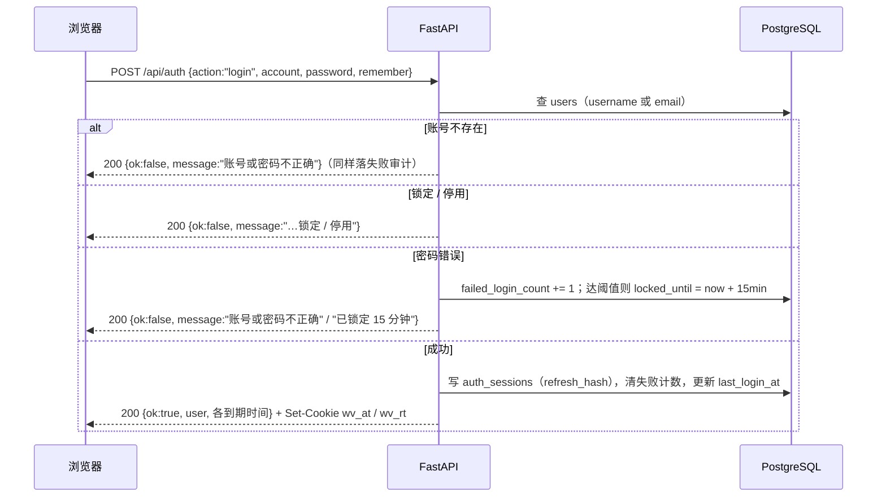

# 04 · 认证与权限

## 1. 设计目标

- 浏览器里的令牌**不能被 JavaScript 读到**（XSS 偷不走）；
- 访问令牌短命，刷新令牌可轮转，被盗用能检测；
- 「账号不存在」与「密码错误」对外不可区分，避免账号枚举；
- 失败也留痕，审计不能只记录成功；
- 权限判断集中在一处，接口只声明需要的权限点。

## 2. 双令牌模型

| 令牌 | 形态 | 有效期 | 存储位置 | 用途 |
|---|---|---|---|---|
| 访问令牌 `wv_at` | JWT（HS256，含 `sub` / `sid` / `jti` / `exp`） | 30 分钟 | httpOnly Cookie，`path=/api` | 所有 API 鉴权 |
| 刷新令牌 `wv_rt` | `secrets.token_urlsafe(32)` 随机串 | 7 天；勾「记住我」30 天 | httpOnly Cookie，`path=/api/auth` | 只用于 `/api/auth/refresh` |

- 数据库里**只存刷新令牌的 SHA-256**（`auth_sessions.refresh_hash`），不存明文。
- 访问令牌自包含，验签即可鉴权，不必回表；但 `sid` 让服务端能判断会话是否已被吊销。
- 会话还有**绝对上限** `absolute_expires_at`（默认 30 天）：无论怎么续期，到点必须重新登录。
  否则一个被偷走的刷新令牌可以靠不断续期永久有效。

Cookie 属性（`app/core/cookies.py`）：

| 属性 | 值 | 原因 |
|---|---|---|
| `HttpOnly` | 是 | JS 读不到 |
| `SameSite` | `Lax` | 跨站 POST 不带 Cookie，挡住常见 CSRF |
| `Secure` | 由 `AUTH_COOKIE_SECURE` 控制 | 本地 http 调试必须关；HTTPS 部署必须开 |
| `Path` | 访问 `/api`；刷新 `/api/auth` | 刷新令牌只在认证接口上出现 |

写接口都要求 `Content-Type: application/json`，跨站发这种请求要先过预检，与 `SameSite=Lax`
组合足够挡住常见 CSRF。没有再加 double-submit 令牌——那要求前端能读 Cookie，等于放弃
「JS 读不到令牌」这条好处。

## 3. 登录流程



关键点：

- 登录失败返回 **HTTP 200 + `ok:false`**，不是 401。401 会被前端拦截器当成「令牌过期」去
  续期，而登录本身还没有会话。前端必须判断 `ok`。
- 失败分支顺序是刻意的：先查账号，再看锁定/停用，最后校验密码。反过来的话，「锁定的账号」
  会在密码错误时提前暴露账号存在。
- 连续失败默认 5 次锁 15 分钟（`AUTH_MAX_FAILED_LOGINS` / `AUTH_LOCK_MINUTES`）；
  锁定时计数清零，解锁后重新给满额次数。
- 登录成功/失败都写 `audit_logs`（`resource_type=auth`, `action=login`），失败带
  `error_message`。

## 4. 刷新与轮转

`POST /api/auth/refresh` 只读 `wv_rt` Cookie：

1. 按 SHA-256 查 `refresh_hash`；
2. 找不到时再查 `prev_refresh_hash` —— 命中说明**上一代令牌被重放**（正常客户端只会用最新
   的那个），整场会话立即吊销（`revoked_reason=reuse_detected`），并写一条失败审计；
3. 会话已吊销 / 过期 / 超过绝对上限 → 401；
4. 用户被停用 → 吊销会话，401；
5. 成功：生成新刷新令牌，旧摘要挪到 `prev_refresh_hash`，`refresh_hash` 换新，
   `expires_at = min(now + TTL, absolute_expires_at)`，签发新访问令牌。

响应同时 `Set-Cookie` 两个新令牌。失败时**自己构造 401 响应**再清 Cookie——如果
`raise HTTPException`，FastAPI 会新建响应对象，之前挂的 `Set-Cookie` 会丢，浏览器会一直
带着一个已经死掉的刷新令牌。

前端要做**单飞续期**：并发 6 个请求同时 401 时只发一次 refresh。否则第一个请求轮转成功，
后 5 个拿着旧令牌会被判定为重放，整场会话反而被吊销（`frontend/src/api/client.ts`）。

## 5. 登出、改密与设备管理

| 动作 | 入口 | 行为 |
|---|---|---|
| 退出当前设备 | `action=logout` | 吊销当前会话，清两个 Cookie |
| 下线其他设备 | `action=logout_all` | `keep_current=true` 保留当前会话，其余吊销 |
| 已登录改密 | `action=change_password` | 校验原密码 → 改哈希 → 吊销其他会话 → 重新签发当前会话 |
| 忘记密码 | `action=forgot_password` | 校验图形验证码 → 生成一次性令牌（30 分钟）→ 落审计 |
| 重发重置 | `action=resend_reset` | 有冷却时间，防止邮件轰炸 |
| 提交新密码 | `action=reset_password` | 校验令牌（未用、未过期）→ 改密 → 吊销该成员全部会话 |

`revoked_reason` 取值：`logout` / `logout_all` / `password_change` / `password_reset` /
`reuse_detected` / `account_disabled` / `migration` / `admin`。前端「登录设备」页按它显示
「为什么下线」。

## 6. 密码

- 哈希：`hashlib.scrypt`，`n=16384, r=8, p=1`，16 字节随机盐，32 字节输出。
  存储格式 `scrypt$n=...,r=...,p=...$salt$hash`，参数随哈希走，日后可平滑升级。
- 没有明文、没有可逆密文；`users.password_hash` 为空表示尚未设置密码。
- 规则（`password_checks`）：
  - 至少 10 位；
  - 含数字、大写、小写、特殊符号；
  - 不含账号名（邮箱 `@` 前按 `. _ -` 切出的 ≥3 位片段）；
  - 两次输入一致。
- 强度条 0–4 段：五条字符类规则各占一格，全部通过且不含账号名才给 4。

## 7. 注册与找回密码

- 注册由 `AUTH_ALLOW_REGISTER` 控制，默认开（内网/演示期）。正式环境建议关掉，由管理员建号。
- 注册写入 `users` + `user_roles`（默认角色），并自动登录。
- 找回密码必须带图形验证码：`GET /api/auth/captcha` 下发，进程内存保存 120 秒。
  **多实例部署要换成 Redis**，否则验证码可能落在另一台实例上。
- 重置令牌只存 SHA-256，一次性、30 分钟；`AUTH_EXPOSE_RESET_TOKEN=true` 时接口直接把
  令牌放进响应，便于本地不走邮件点通流程。**生产必须 false**，否则任何人可重置任意邮箱。
- 「忘记密码」对被注册与被封禁的邮箱返回同样的成功提示，避免账号枚举。

## 8. RBAC

### 8.1 模型

```
users ──< user_roles >── roles ──< role_permissions >── permissions
```

- 权限编码 `模块:动作`，如 `browser:read`。
- `require_permission(code)` 先要求登录，再取该成员所有角色的权限并集；
  `is_superuser=true` 直接放行（只用于初始化与应急）。
- 缺少权限返回 403，`detail` 带上缺失的编码，便于排查。

### 8.2 权限点（35 个）

| 模块 | read | create | update | delete | execute | export |
|---|:--:|:--:|:--:|:--:|:--:|:--:|
| browser | ✓ | ✓ | ✓ | ✓ | ✓ | |
| account | ✓ | ✓ | ✓ | ✓ | | |
| ip | ✓ | ✓ | ✓ | ✓ | | |
| fingerprint | ✓ | ✓ | ✓ | ✓ | | |
| kernel | ✓ | ✓ | ✓ | ✓ | | |
| group | ✓ | ✓ | ✓ | ✓ | | |
| audit | ✓ | | | | | ✓ |
| user | ✓ | ✓ | ✓ | ✓ | | |
| role | ✓ | ✓ | ✓ | ✓ | | |

### 8.3 内置角色

| 角色 | 规则 | 说明 |
|---|---|---|
| `owner` 所有者 | 全部权限 | 工作区创建者 |
| `admin` 管理员 | 除「删除成员 / 删除角色」外全部 | 避免管理员把自己锁死 |
| `operator` 运营 | 读全部 + 实例增改执行 + 账号修改 | 不能建/删资源、不能管成员 |
| `viewer` 只读 | 仅 `read` | 不能做任何写操作 |

内置角色 `is_system=true`，不可删除、不可改编码；`operator` / `viewer` 是普通角色。

### 8.4 接口侧的实际用法

- **写接口**挂 `*:create` / `*:update` / `*:delete` / `*:execute`，完整映射见
  [07 接口参考](07-api-reference.md)。
- **读接口目前几乎没有鉴权**：只有 `/api/user/*` 与 `/api/auth/me` 挂了 `CurrentUser`，
  浏览器池、账号（含 Cookie）、代理（含密码）、指纹、内核、审计、RBAC 的 GET 都是匿名可读。
  这是**已知安全缺口**，不是设计意图：
  - 影响：任何能访问 8000 端口的人都能读到全部资源数据，包括账号 Cookie 与代理口令；
  - 临时缓解：控制台只监听内网 / 加反代认证 / 防火墙限制来源（见 [09 部署](09-deployment.md)）；
  - 彻底修复：给业务路由统一挂 `CurrentUser`，需要区分权限时再加 `require_permission`；
    这会改变现有接口契约，需同步更新测试与集成方。
- 要收紧读权限：在路由上加 `require_permission("xxx:read")`，前端无需改动（403 会走统一
  错误提示）。
- 前端根据 `/api/auth/me` 返回的权限点决定按钮显隐，但**服务端仍然必须校验**：前端隐藏
  只是体验，不是安全边界。

## 9. 审计

认证相关全部落 `audit_logs`：

| 事件 | action | result |
|---|---|---|
| 登录成功 / 失败 | `login` | `success` / `failure` |
| 退出 | `logout` | `success` |
| 注册 | `create`（`resource_type=user`） | `success` / `failure` |
| 找回 / 重置密码 | `reset_password` | `success` / `failure` |
| 刷新令牌重放 | `logout`（失败，detail 说明） | `failure` |

记录包含 `operator`、客户端 IP、User-Agent、`request_id`，可与请求日志对上。
「我的操作日志」接口把 `operator` 钉死为当前登录名，不能查别人。

## 10. 前端配合

`frontend/src/auth/AuthProvider.tsx` 维护三态：`checking` / `authenticated` / `anonymous`。

1. **启动检测**：打开页面先调 `GET /api/auth/session`，未登录返回 200 +
   `authenticated:false`（不是 401，避免触发续期）。
2. **静默续期**：访问令牌剩余 < 5 分钟就调 `/auth/refresh`；轮询每 30 秒一次。
3. **单飞**：`client.ts` 里并发 401 只发一次 refresh，成功后重放原请求。
4. **失效广播**：续期失败 dispatch `auth:expired`，Provider 切匿名态，守卫送回 `/login`。
5. **跨标签同步**：退出时往 `localStorage` 写一个**时间戳**（不是令牌），其他标签监听
   `storage` 事件跟着退出。

守卫：`RequireAuth` 未登录跳 `/login` 并记住来源；`PublicOnly` 已登录访问登录页时送回首页。

## 11. 生产检查清单

- [ ] 修改 `admin` 默认密码，或删除演示账号后重新建号
- [ ] `AUTH_JWT_SECRET` 换成随机 64 位 hex（`secrets.token_hex(32)`）
- [ ] `DB_PASSWORD` 换掉默认值
- [ ] `AUTH_ALLOW_REGISTER=false`
- [ ] `AUTH_EXPOSE_RESET_TOKEN=false`
- [ ] HTTPS 部署：`AUTH_COOKIE_SECURE=true`，按需设 `AUTH_COOKIE_DOMAIN`
- [ ] 反向代理透传 `X-Forwarded-For`，否则审计里的 IP 全是代理地址
- [ ] **不要直接把 8000 暴露到公网**：读接口目前匿名可读（见 8.4），至少加一层反代认证
- [ ] 限制 `6080+` / `9180+` 端口的来源，或只在内网暴露
- [ ] 定期检查 `auth_sessions` 与 `audit_logs` 的增长

## 12. 常见故障

| 现象 | 原因 | 处理 |
|---|---|---|
| 登录成功但下一个请求 401 | Cookie 没带上：跨域、`Secure` 与 http 不匹配、`SameSite=None` 缺 `Secure` | 用同源访问；本地关 `AUTH_COOKIE_SECURE`；检查反代是否改写 Host |
| 页面反复跳登录 | 刷新令牌失效（改密 / 重放检测 / 过期） | 重新登录；查 `auth_sessions.revoked_reason` |
| 并发请求后突然被踢 | 前端没做单飞续期，旧刷新令牌被当重放 | 确认 `client.ts` 的 `refreshOnce` 未被绕过 |
| 验证码总是错 | 多实例部署，验证码在另一台进程内存里 | 单实例部署，或改 Redis |
| 403 但用户是管理员 | 权限编码拼错 / 角色未授权 | 查 `permissions.code` 与 `role_permissions` |
